# Architecture

## System Overview

```mermaid
graph LR
    subgraph Sources
        BN[Binance WebSocket]
    end

    subgraph Ingestion
        P[Python Producer<br/>asyncio + confluent-kafka]
    end

    subgraph Messaging
        K[Apache Kafka / MSK<br/>crypto.trades.v1<br/>crypto.orderbook.v1]
    end

    subgraph Processing
        SS[Spark Structured Streaming<br/>EMR Serverless]
    end

    subgraph Storage
        B[Bronze<br/>Raw JSON Delta]
        S[Silver<br/>Typed, Deduped Delta]
        G[Gold<br/>VWAP, OHLC, Imbalance]
    end

    subgraph Catalog
        GL[AWS Glue Catalog]
        AT[Amazon Athena]
    end

    BN -->|WSS| P
    P -->|produce| K
    K --> SS
    SS --> B
    B --> S
    S --> G
    G --> GL
    GL --> AT
```

## Design Decisions

### Why Kafka over Kinesis?

- **Kafka** offers true partitioning with consumer groups, longer retention, and no shard limits
- MSK provides managed Kafka with multi-AZ replication
- Better ecosystem: Schema Registry, Kafka Connect, ksqlDB
- See [ADR-0002](adr/0002-msk-vs-kinesis.md)

### Why Delta Lake over Iceberg?

- Native Spark integration with `MERGE` for streaming upserts
- `OPTIMIZE` + `VACUUM` for small-file compaction
- Time travel for debugging pipeline issues
- See [ADR-0001](adr/0001-use-delta-lake-over-iceberg.md)

### Why EMR Serverless over Glue Streaming?

- Fine-grained control over Spark configuration
- Lower cost for sustained streaming workloads
- Better debugging via Spark UI
- See [ADR-0003](adr/0003-emr-serverless-vs-glue-streaming.md)

## Data Flow

1. **Producer** connects to Binance combined WebSocket stream
2. Messages are routed by type: `aggTrade` → trades topic, `depthUpdate` → orderbook topic
3. **Bronze job** reads from both topics and lands raw JSON as Delta, partitioned by `dt/hour`
4. **Silver jobs** parse, type-cast, deduplicate (watermark 30s), and upsert into typed Delta tables
5. **Gold jobs** read Silver tables as streaming sources and compute windowed aggregations
6. **Glue Crawlers** register Delta tables in the Data Catalog
7. **Athena** provides SQL access for ad-hoc analysis

## Failure Handling

| Component | Strategy |
|-----------|----------|
| WebSocket disconnect | Exponential backoff (1s → 60s max) with auto-reconnect |
| Kafka producer buffer full | Synchronous poll + retry |
| Spark checkpoint corruption | Manual checkpoint reset via runbook |
| S3 write failure | Spark retry with S3A adaptive retry config |
| Delta merge conflict | Automatic retry (Delta handles OCC internally) |

## Networking (Production)

- VPC with public + private subnets across 3 AZs
- MSK in private subnets with security groups
- EMR Serverless in private subnets with VPC endpoint for S3
- NAT Gateway for outbound Binance WebSocket connection
- No public endpoints except the producer EC2/ECS task
